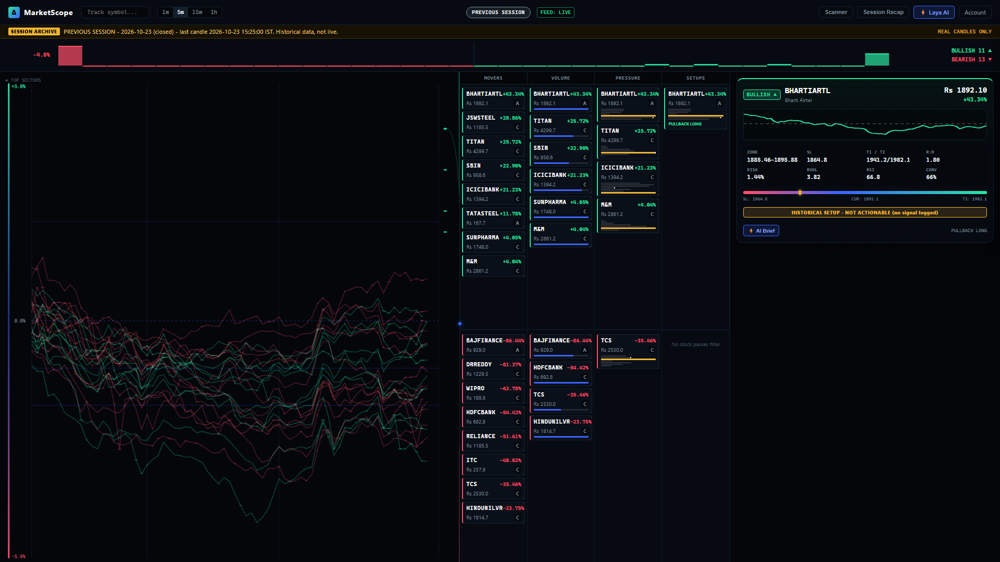
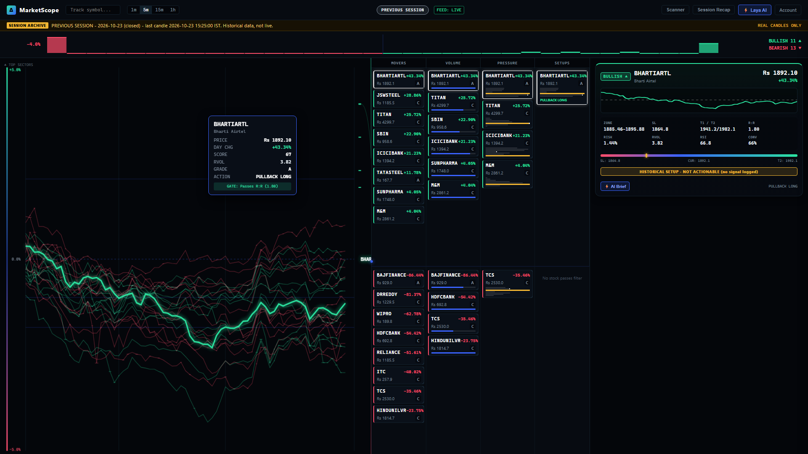
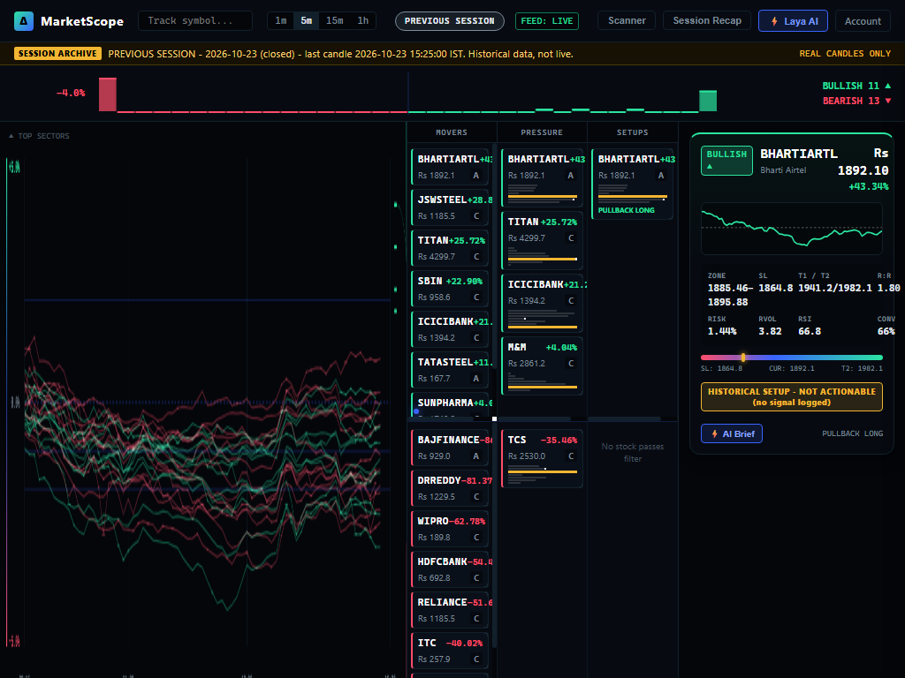

# Zien Quant - Order Block Terminal

[](https://github.com/ekanth14/zien-quant/actions)


**Zien Quant** is a deterministic quantitative trading terminal and order block analysis workstation for Indian cash equities (National Stock Exchange - NSE). Built from the ground up on a **100% Python Standard Library backend** with zero third-party pip dependencies, it delivers deterministic technical order block detection, canvas-rendered intraday flow rivers, automated risk-to-reward gating, and optional local AI trade reasoning powered by Ollama. Data is sourced from Yahoo Finance chart candles; the terminal is a single-owner administrative system and does not rely on direct exchange feeds, Level 2/3 order flow, or institutional participant tracking.

**Version 2.1.0** introduces verified previous close resolution, 1-minute candle matrix streaming with 5-second polling, canvas-rendered trajectory matrix fields, and explicit design preview labeling. The homepage provides the responsive workspace with market overview, stock scanner, watchlist, stock inspection, owner console, and Laya assistant. The Flow River remains available at `/flow`. See the [frontend version notes](docs/FRONTEND_V2.md).

---

## Visual Tour

| Intraday Flow River Terminal | Pinned Setup & Candlestick Profile |
|:---:|:---:|
|  |  |

| Responsive Tablet & Workspace View |
|:---:|
|  |

---

## Core Capabilities

- **Intraday Flow River**: High-framerate HTML5 Canvas stream visualizing price and volume momentum across 75+ intraday candle bars for the liquid NSE universe.
- **4-Stage Funnel Categorization**: Algorithmic classification into **Movers** ($|\Delta\%| \ge 1.0\%$), **Volume** ($RVOL \ge 1.2$), **Pressure** (score $\ge 60$ / $\le 40$), and **Setups** ($R:R \ge 1.5$).
- **Setup Cards with Strict R:R Gating**: Intraday trade opportunities with mathematical validation. Setups require a mandatory **Risk:Reward ratio $\ge 1.5$** anchored to verified swing pivots; invalid or low-expectancy structures are automatically discarded.
- **Zero Synthetic Data Guarantee**: No fake candles, synthetic price randomizers, or invented levels. Missing or off-market data is honestly reflected via dedicated session states.
- **Previous Session Playback Engine**: Automatically computes and replays real persisted Yahoo Finance candle data from the most recent completed market session when the exchange is closed or upstream feeds are down, with built-in holiday awareness.
- **Laya AI Commentary**: Optional local intelligence integration with Ollama (`gemma4:12b`). Features strict regex numerical bounds validation against price discrepancies and a deterministic rules engine fallback.
- **Resilient Upstream Scraper**: Multi-tiered fetcher with exponential backoff, randomized jitter, and an automatic circuit breaker tripping after consecutive upstream errors.
- **Hardened Single-Owner Security**: Multi-factor authentication (TOTP), PBKDF2 HMAC-SHA256 password hashing, anti-CSRF token verification, session tracking, and sliding-window rate limiters.

---

## Prerequisites

| Requirement | Specification | Notes |
|:---|:---|:---|
| **Operating System** | Windows 10/11, Ubuntu 20.04+, Debian 11+, macOS 12+ | Cross-platform compatible |
| **Python** | Python 3.12 or newer | Standard Library only; no `pip install` required |
| **RAM** | 2 GB minimum (16 GB if running local Ollama LLM) | Lightweight stdlib memory footprint |
| **Disk Space** | 250 MB free disk space | SQLite database with WAL mode |
| **Optional LLM** | Ollama with `gemma4:12b` | Optional; terminal operates fully with rules engine |

---

## Quickstart

Run three commands in your terminal to start Zien Quant:

### Linux / macOS
```bash
git clone https://github.com/ekanth14/zien-quant.git && cd zien-quant
bash scripts/setup.sh
python manage.py init-owner
bash scripts/run.sh
```

### Windows (PowerShell)
```powershell
git clone https://github.com/ekanth14/zien-quant.git; cd zien-quant
.\scripts\setup.ps1
python manage.py init-owner
.\scripts\run.ps1
```

Open your browser at: **`http://127.0.0.1:8765/`**

The homepage opens the new reference-inspired workspace; `/index.html` opens the same interface. Open **`http://127.0.0.1:8765/flow`** for the existing Flow River. No frontend build step or Node.js installation is required to run either interface. If no live or archived observations are available, the workspace shows the data-unavailable state instead of generated sample prices.

---

## Step-by-Step Installation Guide

### Step 1: Clone Repository
```bash
git clone https://github.com/ekanth14/zien-quant.git
cd zien-quant
```

### Step 2: Run Setup Script
The automated setup script creates runtime database directories (`work/runtime/`, `work/backups/`), instantiates configuration from `.env.example`, runs SQLite database schema migrations, seeds the top-100 liquid stock master catalog, and tests Ollama status.

- **Linux / macOS**: `bash scripts/setup.sh`
- **Windows**: `.\scripts\setup.ps1`

### Step 3: Initialize Owner Account
Zien Quant operates on a single-owner administrative security model. Initialize your administrative credentials:
```bash
python manage.py init-owner --email "owner@example.com" --password "YourStrongPassword123!"
```
*The command outputs your secret TOTP key. Add this key to your authenticator app (Google Authenticator, Authy, etc.).*

### Step 4: (Optional) Setup Ollama for Local AI Synthesis
If you want deep qualitative reasoning alongside deterministic signals:
1. Install [Ollama](https://ollama.ai).
2. Pull the recommended quantitative reasoning model:
   ```bash
   ollama pull gemma4:12b
   ```
3. Ensure the daemon is running on `http://127.0.0.1:11434`.

*If Ollama is not installed or unreachable, Zien Quant operates seamlessly using its internal 0ms deterministic quantitative rules engine.*

### Step 5: Start Server
```bash
python server.py --host 127.0.0.1 --port 8765
```

### Step 6: Verify System Health
Run the terminal doctor check:
```bash
python manage.py doctor
```

---

## Terminal User Guide

### 1. The Flow River Visualization
The top panel renders the **Flow River**, an animated intraday price & volume flow display.
- **Horizontal Axis**: 75 rolling 5-minute candles across the trading day (09:15 to 15:30 IST).
- **Vertical Spread**: Percentage deviation from session open (-3% to +3%).
- **Color Coding**: Emerald green streams denote bullish momentum; magenta/amber streams denote bearish pressure or consolidation.
- **Interactive Tooltips**: Hover over any stock stream to inspect current RSI, Relative Volume (RVOL), VWAP distance, and composite score. Click to pin the inspector card.

### 2. The 4 Funnel Stages
All tracked equities pass through a continuous mathematical pipeline:
1. **Movers**: Intraday price change threshold filter ($|\Delta\%| \ge 1.0\%$).
2. **Volume**: Relative Volume expansion ($RVOL \ge 1.2$).
3. **Pressure**: Directional algorithmic composite score ($\ge 60$ for bullish, $\le 40$ for bearish).
4. **Setups**: Technical setup qualification requiring execution grade (A+, A, B) and risk-to-reward ratio gating ($R:R \ge 1.5$).

### 3. Setup Cards & R:R Gating
Actionable trade setups are rendered as cards in the lower console:
- **Mandatory R:R Gate**: Every trade setup requires a minimum calculated Risk:Reward ratio of **1.5**.
- **Stop Loss & Target Calculation**: Stops are anchored beyond technical order block invalidation thresholds; targets are set at opposing liquidity boundaries. Setups failing the R:R threshold or missing verified candle levels are suppressed.
- **Conviction Score**: Ranked 0 to 100 based on multi-timeframe trend alignment, VWAP positioning, and volume confirmation.

### 4. Session States & Honest Transparency
- **`LIVE` (Green Badge)**: Market is open (Monday–Friday, 09:15–15:30 IST), and live Yahoo Finance chart candles are streaming.
- **`CLOSED` (Slate Badge)**: Market is closed (weekends, evenings, or NSE official holidays). The terminal displays the **Previous Session view**, reconstructing the entire terminal from real, verified historical candles of the last completed session.
- **`FEED_DOWN` (Amber Badge)**: Upstream feed outage detected. The terminal alerts the user immediately and switches to the last verified snapshot without fabricating fallback data.

### 5. Laya AI Commentary & Numerical Validator
- When Ollama is active, the terminal badge displays **`AI - gemma4:12b`**.
- When Ollama is offline or processing, the badge displays **`Rules engine`**.
- Every AI output is verified by a strict numerical consistency validator that verifies reported price levels against actual input data within 0.2%, disallowing invented targets, stops, or percentages. Note that the validator checks numerical consistency only; it does not verify conceptual statements.

---

## Architecture Overview

```
                                  +-----------------------+
                                  | Yahoo Finance Feed    |
                                  +-----------+-----------+
                                              |
                                              v
+-----------------------+         +-----------------------+
|  Local Ollama LLM     | <-----> |   Scraper & Archive   | (Circuit Breaker,
|  (gemma4:12b)         |         |   (WAL SQLite Cache)  |  Exponential Backoff)
+-----------------------+         +-----------+-----------+
                                              |
                                              v
+-----------------------+         +-----------------------+
|  Deterministic        | <-----> |   Session Manager &   | (Multi-tier Snapshot,
|  Quantitative Engine  |         |   Schedule Matrix     |  Off-Market Playback)
+-----------------------+         +-----------+-----------+
                                              |
                                              v
                                  +-----------------------+
                                  |  HTTP Server (Stdlib) | (PBKDF2 Auth, CSRF,
                                  |  REST APIs & Gzip     |  Rate Limiting)
                                  +-----------+-----------+
                                              |
                                              v
                                  +-----------------------+
                                  | Flow Terminal (WebUI) | (Pure HTML5 Canvas,
                                  | Vanilla JS + CSS3     |  Zero NPM/CDN deps)
                                  +-----------------------+
```

- **Runtime Zero-Pip**: Zero external pip modules. All HTTP routing, thread pooling, cryptographic authentication, and JSON/Gzip serialization run on standard library modules.
- **Database Engine**: SQLite 3 with Write-Ahead Logging (`PRAGMA journal_mode=WAL`), isolated connection pools, and migration scripts.
- **Frontend Core**: Handcrafted Vanilla JavaScript (ES2022) and CSS3; zero external CDNs, bundlers, or remote fonts. Completely operational in air-gapped environments.

---

## Security Model

- **Authentication Matrix**: Role-based access control distinguishing between `owner`, authenticated `trader`, and public read-only viewers.
- **Local Data Sovereignity**: Trade queries, logs, and AI synthesis remain entirely on local hardware (`127.0.0.1`).
- **CSRF Defense**: Session-bound cryptographic tokens required on all POST, PUT, and DELETE actions.
- **Sliding-Window Rate Limiting**: IP-based rate limiting prevents brute-force authentication and API abuse.

---

## Management CLI

Execute administrative operations from the repository root:

```bash
# Comprehensive health and diagnostic audit
python manage.py doctor

# Initialize or inspect owner configuration
python manage.py init-owner
python manage.py status

# Create an ACID-safe SQLite database backup
python manage.py backup

# Import equity master database from CSV or seed top 100
python manage.py import-stock-master [path/to/nse_master.csv]

# Inspect candle archive row counts and timeframes
python manage.py candle-stats
```

---

## Deployment

### Docker Deployment (Untested)
Reference deployment manifests are provided under `marketscope/deploy/` (`Dockerfile`, `docker-compose.yml`, `Caddyfile`). Because Docker was not present in the local verification environment, these manifests are currently **untested** and provided as community deployment templates.

---

## Testing

Run the full automated test suite (142 tests) directly with Python's built-in test runner:

```bash
python -m unittest discover -s tests
```

Run syntax and bytecode compilation verification:
```bash
python -m compileall -q .
```

Run secret scanner:
```bash
python scripts/secret_scan.py --working-tree-only
```

---

## Documentation

For specialized setup and engineering documentation:
- [Deep-Dive Installation & Systemd Service](docs/INSTALL.md)
- [System Architecture & Data Schemas](docs/ARCHITECTURE.md)
- [Configuration & Environment Variables](docs/CONFIGURATION.md)
- [Complete REST API Reference](docs/API.md)
- [Troubleshooting & Diagnostics](docs/TROUBLESHOOTING.md)

---

## License & Copyright

Copyright (c) 2026. All rights reserved.

Unauthorized copying, distribution, or modification of this software via any medium is strictly prohibited without explicit written permission.
