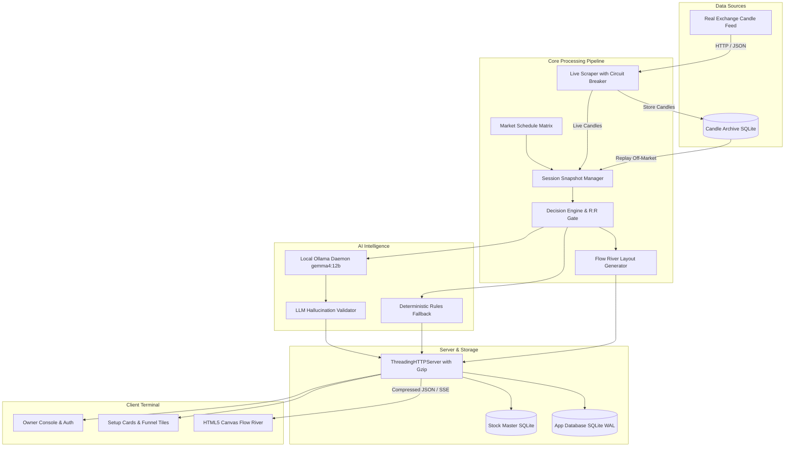

# Zien Quant - System Architecture & Internal Design

This document details the architectural design, threading model, database schemas, and data pipelines of the Zien Quant Order Block Terminal.

---

## 1. System Overview



---

## 2. Threading Model & Concurrency

Zien Quant runs a multithreaded architecture leveraging standard library concurrency:

1. **Main Server Thread (`ThreadingHTTPServer`)**:
   - Dispatches each incoming HTTP client request onto an isolated worker thread.
   - Applies security middleware (rate-limiting, CSRF verification, session resolution) per connection.
2. **Background LLM Synthesis Worker (`LayaAIWorker`)**:
   - Manages a FIFO queue (`queue.Queue(maxsize=20)`) of stock analysis jobs.
   - Pings local Ollama asynchronously in the background so HTTP request threads never block on LLM inference.
   - Updates an in-memory analysis cache upon completion.
3. **Scraper Parallelism (`ThreadPoolExecutor`)**:
   - Fetches live exchange symbols concurrently with configurable worker caps.
   - Incorporates randomized jitter and exponential backoff to avoid exchange rate limiting.
4. **SQLite Concurrency**:
   - Databases utilize SQLite Write-Ahead Logging (`PRAGMA journal_mode=WAL;`).
   - Multiple reader threads execute concurrently without blocking write operations.

---

## 3. Database Schemas

### 3.1 Application Database (`work/runtime/marketscope.db`)

#### Users & Authentication
```sql
CREATE TABLE IF NOT EXISTS users (
    id TEXT PRIMARY KEY,
    email TEXT UNIQUE NOT NULL,
    password_hash TEXT NOT NULL,
    role TEXT NOT NULL DEFAULT 'viewer',
    totp_secret TEXT,
    plan TEXT NOT NULL DEFAULT 'standard',
    created_at TIMESTAMP DEFAULT CURRENT_TIMESTAMP
);
```

#### Active Sessions
```sql
CREATE TABLE IF NOT EXISTS sessions (
    token TEXT PRIMARY KEY,
    user_id TEXT NOT NULL,
    ip TEXT NOT NULL,
    user_agent TEXT NOT NULL,
    expires_at TIMESTAMP NOT NULL,
    created_at TIMESTAMP DEFAULT CURRENT_TIMESTAMP,
    FOREIGN KEY(user_id) REFERENCES users(id) ON DELETE CASCADE
);
```

#### Dynamic Configuration Versions
```sql
CREATE TABLE IF NOT EXISTS config_versions (
    version_id INTEGER PRIMARY KEY AUTOINCREMENT,
    version_hash TEXT NOT NULL,
    config_json TEXT NOT NULL,
    applied_by TEXT NOT NULL,
    created_at TIMESTAMP DEFAULT CURRENT_TIMESTAMP
);
```

#### Shadow & Historical Signals
```sql
CREATE TABLE IF NOT EXISTS signals (
    id TEXT PRIMARY KEY,
    symbol TEXT NOT NULL,
    signal_type TEXT NOT NULL,
    score REAL NOT NULL,
    entry_price REAL NOT NULL,
    stop_loss REAL NOT NULL,
    target_price REAL NOT NULL,
    rr_ratio REAL NOT NULL,
    stage TEXT NOT NULL,
    timestamp INTEGER NOT NULL,
    created_at TIMESTAMP DEFAULT CURRENT_TIMESTAMP
);
```

### 3.2 Candle Archive Database (`work/runtime/candles.db`)
```sql
CREATE TABLE IF NOT EXISTS candle_bars (
    symbol TEXT NOT NULL,
    timeframe TEXT NOT NULL,
    timestamp INTEGER NOT NULL,
    open REAL NOT NULL,
    high REAL NOT NULL,
    low REAL NOT NULL,
    close REAL NOT NULL,
    volume REAL NOT NULL,
    PRIMARY KEY(symbol, timeframe, timestamp)
);
CREATE INDEX IF NOT EXISTS idx_candles_lookup ON candle_bars(symbol, timeframe, timestamp DESC);
```

### 3.3 Stock Master Database (`work/runtime/stock_master.db`)
```sql
CREATE TABLE IF NOT EXISTS stocks (
    symbol TEXT PRIMARY KEY,
    name TEXT NOT NULL,
    exchange TEXT NOT NULL DEFAULT 'NSE',
    series TEXT NOT NULL DEFAULT 'EQ',
    isin TEXT,
    listing_date TEXT,
    sector TEXT NOT NULL DEFAULT 'General',
    face_value TEXT DEFAULT '10',
    bse_code TEXT,
    updated_at TIMESTAMP DEFAULT CURRENT_TIMESTAMP
);
CREATE INDEX IF NOT EXISTS idx_stocks_sector ON stocks(sector);
```

---

## 4. Quantitative Processing & R:R Gating

The terminal computes institutional setups deterministically:
1. **Pivot & Order Block Identification**:
   - Pivot Highs: $High_t > High_{t-1} \land High_t > High_{t+1}$
   - Pivot Lows: $Low_t < Low_{t-1} \land Low_t < Low_{t+1}$
   - Origin Order Block: The last down candle prior to an impulsive upside break, or last up candle prior to an impulsive downside break.
2. **Mathematical Expectancy & Risk:Reward**:
   $$\text{Risk} = |\text{Entry} - \text{Stop Loss}|$$
   $$\text{Reward} = |\text{Target} - \text{Entry}|$$
   $$\text{R:R Ratio} = \frac{\text{Reward}}{\text{Risk}}$$
   $$\text{Gate}: \text{R:R Ratio} \ge 1.5$$
   Any setup with $\text{R:R} < 1.5$, $\text{Risk} \le 0$, or $\text{Reward} \le 0$ is strictly filtered out.

---

## 5. Previous Session Replay Engine

When the market schedule indicates `CLOSED` (e.g. weekends or outside 09:15-15:30 IST):
1. **Target Date Computation**: Traverses backwards from the current date to find the most recent trading weekday not listed in the NSE official holiday calendar.
2. **Candle Retrieval**: Queries `candles.db` for all 5m candles corresponding to that target trading date.
3. **Deterministic Reconstruction**: Feeds the real historical candles through the scoring, order block, and flow river layout engines.
4. **Metadata & Status**: Marks the response with `session_state: "CLOSED"`, `is_previous_session: true`, and the target session date.
